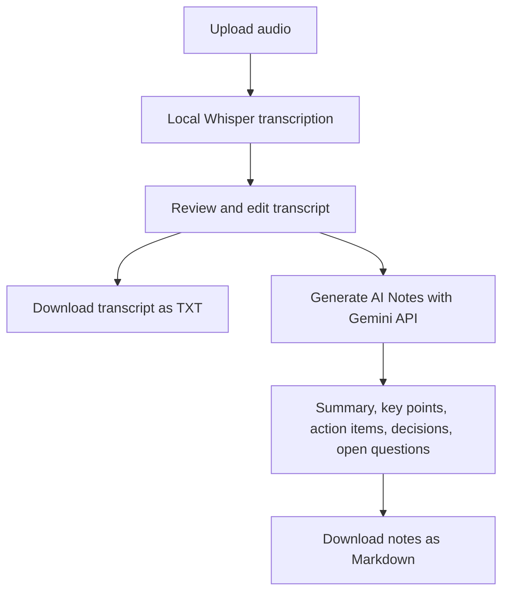
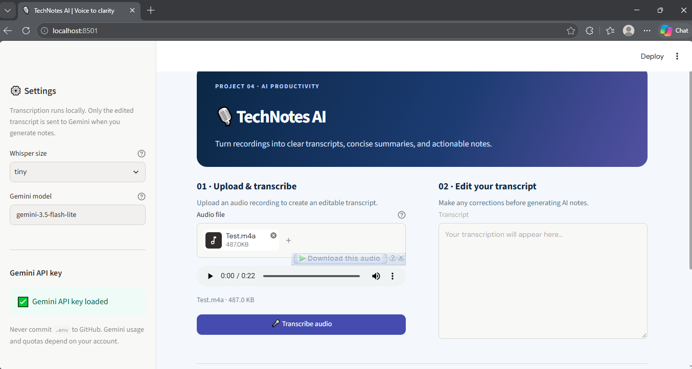
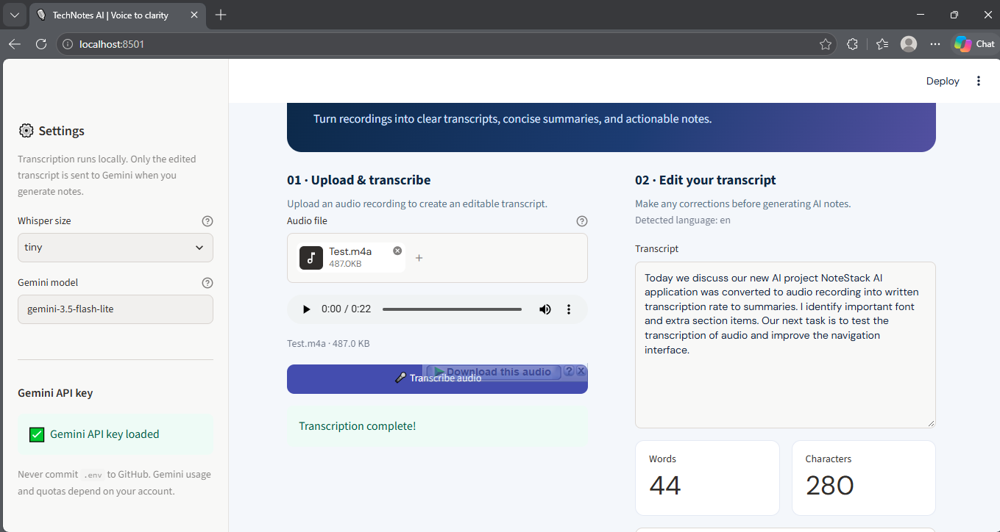
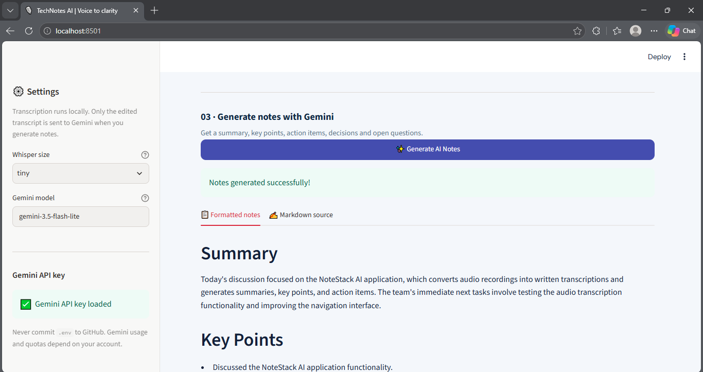

# 🎙️ TechNotes AI — Audio Transcription & Smart Notes

**Python · Streamlit · faster-whisper · Google Gemini**

TechNotes AI is a locally run web application that turns audio recordings into **editable transcripts**, then uses **Google Gemini** to generate organized notes with summaries, key points, action items, decisions, and open questions.

> **Privacy note:** Audio transcription runs locally through `faster-whisper`. When a user clicks **Generate AI Notes**, the *edited transcript text* is sent to the Google Gemini API. No personal voice samples are included in this repository.

## Features

- Upload MP3, WAV, M4A, MP4, OGG, and FLAC files and play them in the browser.
- Transcribe speech locally using Whisper models (`tiny`, `base`, or `small`) on CPU with `int8` inference.
- Review and edit transcripts before generating notes.
- Download transcripts as `.txt` files.
- Generate **Summary**, **Key Points**, **Action Items**, **Decisions**, and **Open Questions** using Gemini.
- Download formatted AI notes as Markdown (`.md`).
- Clear previous transcript and notes automatically when a different audio file is uploaded.

## Technology stack

| Component | Technology |
|---|---|
| Application | Python, Streamlit |
| Speech recognition | `faster-whisper` (local Whisper model) |
| Note generation | Google Gemini API through `google-genai` |
| Environment variables | `python-dotenv` |
| Temporary audio handling | Python `tempfile` |

## How it works



## Screenshots

| App screen | Preview |
|---|---|
| Dashboard |  |
| Transcription |  |
| AI-generated notes |  |

> Screenshots show the local demonstration. The application does not require publishing personal recordings.

## Project structure

```text
technotes-ai/
├── app.py
├── requirements.txt
├── README.md
├── .env.example
├── .gitignore
├── docs/
│   └── test-checklist.md
└── screenshots/
    ├── Dashboard.PNG
    ├── Transcription.PNG
    └── AI_Summary.PNG
```

`.env` and `.venv/` are used locally but **must not be committed**. A `sample_audio/` folder is not required.

## Installation — Windows / VS Code

**Prerequisites:** Python, a Gemini API key, and internet access for the initial Whisper model download and Gemini requests.

1. Clone the repository and enter its folder:

   ```powershell
   git clone https://github.com/YOUR-USERNAME/technotes-ai.git
   cd technotes-ai
   ```

2. Create a virtual environment:

   ```powershell
   py -m venv .venv
   ```

3. Install dependencies:

   ```powershell
   .\.venv\Scripts\python.exe -m pip install -r requirements.txt
   ```

4. Copy `.env.example` to `.env`, then set your Gemini API key:

   ```dotenv
   GEMINI_API_KEY=your_gemini_api_key_here
   ```

   Obtain a key through [Google AI Studio](https://aistudio.google.com/apikey). **Never commit `.env` or share the real key.**

5. Run the app:

   ```powershell
   .\.venv\Scripts\python.exe -m streamlit run app.py
   ```

6. Open the local URL shown in the terminal, usually `http://localhost:8501`.

## Usage

1. Select the Whisper model in the sidebar (`tiny` is generally fastest on a CPU-only machine).
2. Upload an audio file and click **Transcribe audio**.
3. Correct any errors in the **Transcript** editor.
4. Optionally download the transcript as `.txt`.
5. Click **Generate AI Notes** to send the edited transcript to Gemini.
6. Review the formatted output, then download the `.md` notes.

The Gemini model name is editable in the sidebar; use a model supported by your API account. Availability and pricing depend on Google.

## Local testing

The following behaviors were demonstrated during development:

- Streamlit loaded on `localhost:8501`.
- An M4A audio file uploaded and transcribed successfully using local Whisper.
- The transcript editor and TXT download worked.
- Gemini returned structured notes including a summary, key points, and action items.
- The Markdown notes download worked.

See [`docs/test-checklist.md`](docs/test-checklist.md) for the project test checklist. Before relying on the results, test with additional permitted recordings and review the transcript and summary for accuracy.

## Limitations

- Recognition quality varies with background noise, accents, speech clarity, language, and model size.
- Gemini notes may omit or misstate details; human review is essential.
- Gemini note generation requires an API key and an internet connection and may be subject to quotas or charges.
- This is a local MVP, not a hosted multi-user service or a production-grade confidential-recording system.

## Security and privacy

- Whisper processes the uploaded audio locally in a temporary file.
- The edited transcript is sent to Google only when **Generate AI Notes** is clicked.
- Keep `.env`, `.venv/`, personal voice files, API credentials, and confidential transcripts out of the repository.
- Do not upload recordings of others without appropriate permission.
- Review screenshots before committing to ensure they contain no private information.

## Author

**Rabia Batool**

Developed as a hands-on AI application and automation portfolio project.
